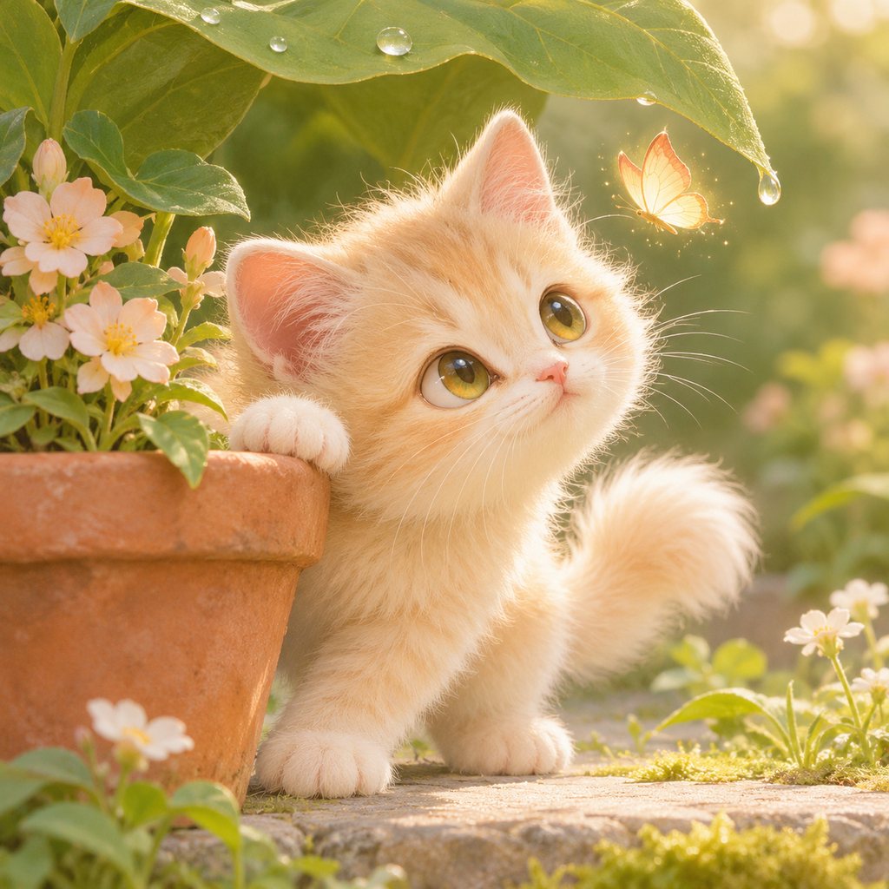

# Cutest cat

A deterministic Python program that copies one fixed kitten picture to `entry.png`.

The picture was created with the ChatGPT website at the user's request: a fluffy cream kitten in a garden, one paw on a flowerpot, watching a glowing butterfly. The full frame was resized proportionally to 1024 by 1024. A lossless PNG of that resize is larger than 1 MiB (1048576 bytes), so the stored file is a baseline JPEG, quality 99, 4:4:4. The program writes those exact bytes. The output filename is `entry.png`; the format follows the JPEG magic number.

The grader runs Python 3.13 with the standard library only. This program installs nothing and does not use the network. It reads `assets/kitten.jpg` next to `main.py`, not from the working directory.

## Run

```sh
mkdir -p out && MAKEFUN_OUTPUT_DIR=out python3 main.py
```

With `MAKEFUN_OUTPUT_DIR` unset, the program writes `/output/entry.png`.

```sh
python3 validate.py
```

`validate.py` checks two copies, the file size and dimensions, a different working directory, and the environment override. It records this machine's wall time. Official make.fun grading is a separate run.

## Picture



`preview.jpg` and `assets/kitten.jpg` are the same bytes.

## License

MIT. The copy program is in this repository. The picture was created with the ChatGPT website at the user's request.

## Scope

This repository holds the fixed image, the copy program, and a local validation report. Wallet signing, contest submission, and transcript export stay outside it. The transcript policy is unresolved. This entry is not submitted and is not accepted.
