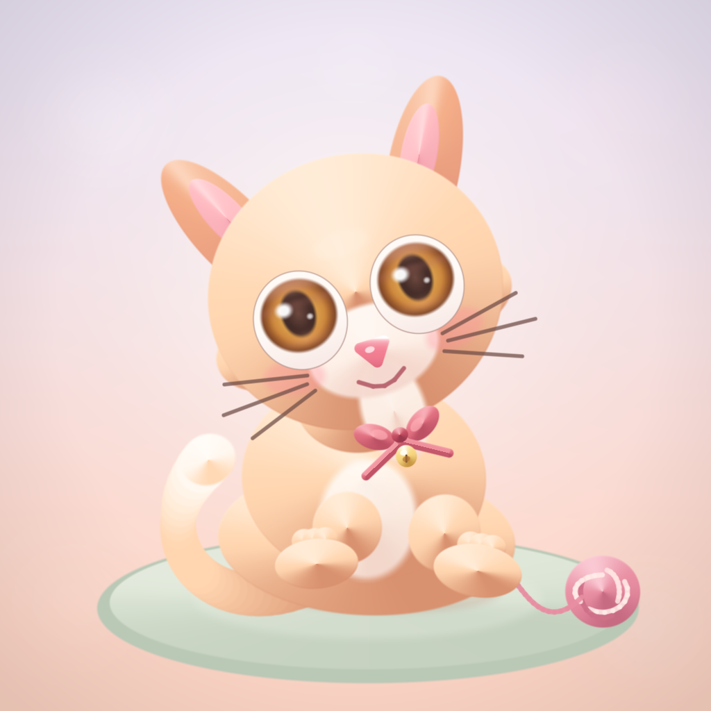

# Cutest cat

A deterministic Python program that draws one original kitten and writes `entry.png`.

The grader runs Python 3.13 with the standard library only. The program installs nothing and does not use the network. The picture is a whole PNG, at most 1024 by 1024 pixels and at most 1 MiB (1048576 bytes). Two runs write the same bytes.

## Run

```sh
mkdir -p out && MAKEFUN_OUTPUT_DIR=out python3 main.py
```

With `MAKEFUN_OUTPUT_DIR` unset, the program writes `/output/entry.png`.

```sh
python3 validate.py
```

`validate.py` checks that command, the repeated hash, the dimensions, and the file size. It records this machine's wall time. Official make.fun grading is a separate run.

## Picture

The kitten is drawn in `main.py`, not copied from an image: apricot fur, a tilted head, large amber eyes, a small bow and bell, a curled tail, and a ball of yarn on a sage rug.



## License

MIT. The program and the illustration are original.

## Scope of this repository

This repository holds the generator source and a local validation report. Wallet signing, contest submission, and transcript export are outside it. The transcript policy is unresolved, so this source is neither claimed complete for entry nor accepted.
